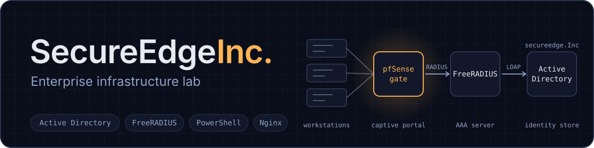

<p align="center"></p>

# SecureEdge Inc. Project

A team lab that builds the IT foundation of a fictional company, SecureEdge Inc.: an Active Directory domain with scripted user provisioning, captive-portal network access control backed by FreeRADIUS, Group Policy security and workstation settings, a network utility in Python and an internal Nginx documentation portal.

Mid project for ICC:03 (Intesive CyberSecurity Course 2025/26)

## Contents

- [Principles](#principles)
- [Lab environment](#lab-environment)
- [What was built](#what-was-built)
- [How the repository is organised](#how-the-repository-is-organised)
- [Limits of this exercise](#limits-of-this-exercise)
- [Responsible use](#responsible-use)

## Principles

- Least privilege: access policies give each person only the tools and permissions the job needs. Only the IT manager can change the system time, and only IT-approved software can be installed.
- Identity and access management and the AAA model (authentication, authorization, accounting) shape both the policies and the network access design.
- The policy work follows NIST publications (SP 800-53 Rev. 5, CSF 2.0 and the CSF small business guide), listed in [Security Policies/Documents](Security%20Policies/Documents/README.md).
- Policies are graded Critical, Needed or Recommended, sized to the company, and meant to be revisited as it grows.
- Unauthenticated users stay restricted until a login against Active Directory succeeds, and sessions are logged for audit.

## Lab environment

The repository documents these components and how they connect:

```
workstations -> pfSense captive portal -> FreeRADIUS -> Active Directory (domain secureedge.Inc)
```

| Component | Role | Source |
|-----------|------|--------|
| Domain controller | Authentication and directory services for the `secureedge.Inc` domain, with one OU per department | [AD README](Active%20Directory%20(AD)%20Setup/README.md) |
| pfSense captive portal | Network access server: intercepts unauthenticated HTTP and HTTPS traffic and redirects users to a login page | [NAC README](Network%20Access%20Control%20(NAC)/README.md) |
| FreeRADIUS | AAA server: receives the portal's RADIUS request and checks the user against Active Directory over LDAP | [NAC README](Network%20Access%20Control%20(NAC)/README.md) |
| Group Policy | Applies password, lockout, access and workstation policies at domain and OU level | [Security Policies](Security%20Policies/README.md) |
| Workstations | Receive the same taskbar and company wallpaper through Group Policy | [Workstation Standardization](Workstation%20Standardization/README.md) |
| Nginx | Internal documentation portal on port 80, served as `securedge.inc` through a local `hosts` entry | [NGINX README](NGINX/README.md) |

The repository does not document host names, IP addresses, DNS or DHCP settings, so none are given here.

## What was built

### Active Directory setup ([AD setup](Active%20Directory%20(AD)%20Setup/))

[Script_OU_USERS.ps1](Active%20Directory%20(AD)%20Setup/Script_OU_USERS.ps1) reads a CSV (`Firstname`, `Lastname`, `Username`, `Department`, `Password`), creates a department OU under `DC=secureedge,DC=Inc` if missing, then creates each enabled user with the UPN `<username>@secureedge.Inc` if the account does not already exist. The CSV is not part of the repository.

### Network Access Control ([NAC](Network%20Access%20Control%20(NAC)/))

Captive portal on the LAN interface, FreeRADIUS installed from the pfSense package manager, and an LDAP authentication server pointing at Active Directory, with a dedicated OU, group and user for pfSense. The theory and steps are in [Network Access Control (NAC).md](Network%20Access%20Control%20(NAC)/Network%20Access%20Control%20(NAC).md). The MVP scope, deliverables and success criteria (for example, failed authentication denies access and the system works for at least 5 concurrent test users) are in the [MVP document](Network%20Access%20Control%20(NAC)/MVP_%20Captive%20Portal%20with%20FreeRADIUS%20and%20Active%20Directory%20Integration%20nome.md).

### Security policies ([Security Policies](Security%20Policies/))

| Area | Setting |
|------|---------|
| Password history | Last 8 passwords |
| Password age | Maximum 30 days, minimum 29 days |
| Password length | At least 10 characters, complexity required |
| Account lockout | 5 invalid attempts, 20 minute lockout, counter reset after 15 minutes |
| System time | Only the IT manager can change it |
| Windows Installer | Disabled for users; only IT-approved applications |

The [PDF guide](Security%20Policies/Documents/Secure%20Policies_and_Access_Privileges.pdf) adds recommendations by level (control panel and command prompt restricted to IT, BitLocker, removable storage blocked, lock screen, browser extension control, hibernation). A [Group Policy Management user guide](Security%20Policies/Documents/Group%20Policy%20Management%20-%20User%20Guide.pdf) shows how to create and link a GPO to a user, group or OU.

### Workstation standardization ([Workstation Standardization](Workstation%20Standardization/))

Group Policy locks the taskbar (no resizing, moving or rearranging, no taskbar control panel), disables balloon notifications and deploys one company wallpaper with the SecureEdge Inc. logo.

### Network tool ([NetworkTool](NetworkTool/))

[networktool.py](NetworkTool/networktool.py) is a single-file, cross-platform Python menu: ping a host, concurrent TCP port scan, network traffic measurement (needs `psutil`) and device discovery from the ARP table. [setup.ps1](NetworkTool/setup.ps1) installs Python 3.11.5 if missing and then `psutil`. A [technical report](NetworkTool/Network%20Tool%20for%20Security%20Edge%20Inc..pdf) describes the design.

### Internal documentation portal ([NGINX](NGINX/))

[ngixdeployment.ps1](NGINX/ngixdeployment.ps1) checks for administrator rights, downloads Nginx 1.25.3 if absent, generates `nginx.conf`, adds the `hosts` entry, validates the configuration with `nginx.exe -t` and starts the server. [index.html](NGINX/index.html) is the portal page. An [MVP report](NGINX/SecureEdge%20Inc.%20%E2%80%93%20Internal%20Documentation%20Portal%20(Nginx).pdf) covers the design.

## How the repository is organised

| Folder | Contents |
|--------|----------|
| [Active Directory (AD) Setup](Active%20Directory%20(AD)%20Setup/) | README and `Script_OU_USERS.ps1` |
| [Network Access Control (NAC)](Network%20Access%20Control%20(NAC)/) | README, NAC guide and MVP document |
| [Security Policies](Security%20Policies/) | Policy README and `Documents/` (policy PDF, GPO guide, references) |
| [Workstation Standardization](Workstation%20Standardization/) | README and the `MVP` note |
| [NetworkTool](NetworkTool/) | `networktool.py`, `setup.ps1`, README and report |
| [NGINX](NGINX/) | Deployment script, `index.html`, README and report |

## Limits of this exercise

- This is a lab and MVP exercise: the repository holds scripts, written guides and screenshots, not exported pfSense, FreeRADIUS or Group Policy configurations.
- The provisioning script reads initial passwords in plain text from the CSV. Protect that file and delete it after use.
- The Nginx portal serves HTTP only. The MVP report lists HTTPS and Active Directory authentication as future work, and the portal page itself holds placeholder links and announcements.
- The network tool reads the ARP cache, so it only finds devices the host has already talked to. Its port scan is a TCP connect scan.
- Some policies, such as the Windows Installer block, are meant to be upgraded (for example to AppLocker) as the company grows.

## Responsible use

Everything here is meant for a lab or an environment you own or are authorised to administer. Run the port scan and device discovery only on networks you have permission to test. Do not reuse the example domain, hosts entry or default values in production.
